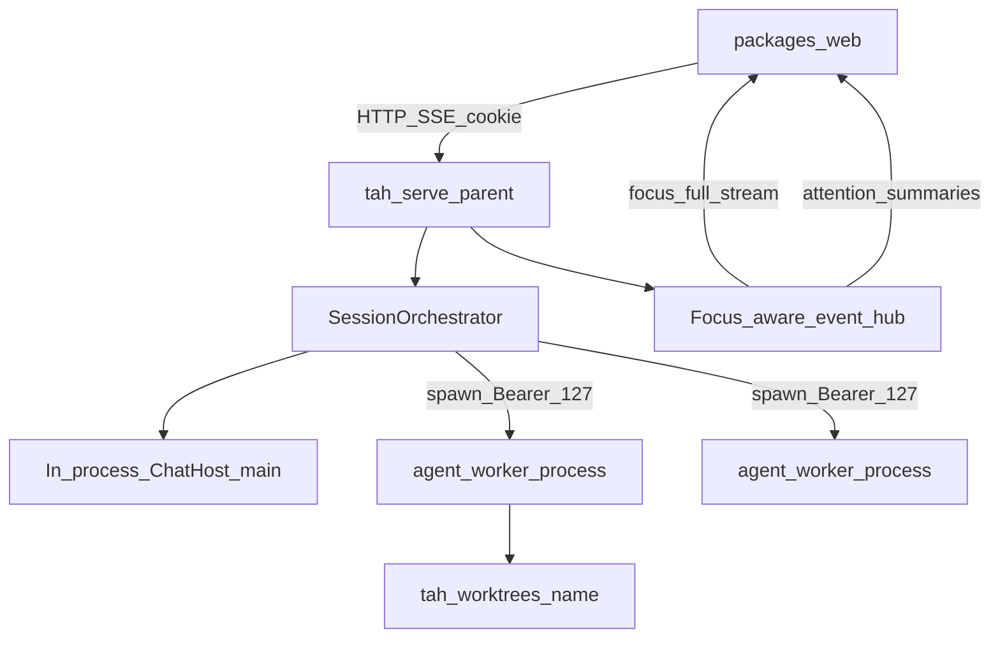

# 并行 Session（Claude 风格 worker）

状态：📐 已设计（未实现）

对齐 [Claude Code 并行 session / worktree](https://code.claude.com/docs/en/worktrees)：并行 = **多个独立 Agent 进程**，文件隔离靠 **git worktree**，不是同 cwd 抢写。本机工作台 `tah serve` 做编排与 UI；`tah chat` / `tah agent-host` 第一版不动。

相关现状：[serve](../../design/serve.md)、[workspaces](../../design/workspaces.md)、[queue](../../design/queue.md)、[browser](../../design/browser.md)、[agent-host](../../design/agent-host.md)。

## 背景

今天 `tah serve` 进程内一个 `ChatHost`、一轮全局 `busy`；切文件夹要 `hub.assertIdle()`；工具事件不带多会话归属。Claude Code 的主路径是：每个并行任务一个进程 + 独立 worktree checkout，工程师用多终端或总览去盯需要自己的时刻。

本设计把同一模型放进 **一个** `tah serve` 网页：父进程编排子进程 worker，侧栏同时挂多个在跑的 session。

## 目标

- `tah serve` 内可同时跑多路 Agent 轮次（真并行）。
- 并行 session 默认落在 git worktree（路径与分支约定见下）；非 git 仓库第一版明确报错。
- 网页：单焦点 transcript；侧栏显示并行状态；后台 `approval` / `ask_user` 有全局提示并可切到对应 session。
- 浏览器 profile 按 worker 隔离，避免多进程抢 `~/.tah/browser-profile`。

## 非目标

- 第一版不改 `tah chat` / TUI、`tah agent-host` / 控制面。
- 不保证同主 checkout 上两路并行写文件安全（文档写明：并行请用 worktree）。
- 不做 Agent teams、cross-session messaging、`/batch` 级扇出（列后续）。
- 不做分屏同时看两路完整 transcript。
- 不做非 git VCS 的 worktree hooks（Claude 有；我们 v1 不做）。

## 决策摘要

| 项 | 选择 |
| --- | --- |
| 并行含义 | 多路同时跑 LLM/工具（真并行） |
| 隔离 | git worktree（对齐 Claude），非同 cwd 文件锁 |
| 进程 | 并行 = 子进程；主文件夹可留父进程内 `ChatHost` |
| 界面范围 | 仅 `tah serve` |
| UI | 单焦点 + attention 提示；批准前必须切焦点 |

## 架构

```text
浏览器 (packages/web)
        │  cookie + HTTP/SSE（带 workerId）
        ▼
tah serve 父进程
  ├── SessionOrchestrator   列表 / 焦点 / worktree / spawn·回收
  ├── 焦点感知 hub          焦点全量回放；后台摘要 + attention
  ├── 主文件夹 ChatHost     （进程内，兼容现状）
  └── 静态页 / workspaces / Settings / browser panel（只绑焦点）
        │ 127.0.0.1 + Bearer (TAH_WORKER_TOKEN)
        ▼
tah agent-worker × N
  └── ChatHost + Runtime（cwd = worktree 或指定目录）
```



| 模块 | 职责 |
| --- | --- |
| `packages/cli/src/serve/`（扩展） | Orchestrator、焦点 hub、父进程 HTTP 路由、`workerId` |
| 新增 `packages/cli/src/agent-worker/`（或同级命名） | 子进程：本机 HTTP + SSE `HostEvent`，无静态页 |
| `packages/cli/src/host.ts` | 仍为单会话 `ChatHost`；多会话靠多进程，不把 Runtime 改成多租户 |
| `packages/cli/src/browser.ts` | profile 目录按 worker/cwd 隔离 |
| `packages/web` | 侧栏 busy / attention；写操作带 `workerId` |

Worker **不**服务网页静态资源、workspaces、Settings、browser panel HTTP。父进程是浏览器唯一入口。

进程内仍是「一个 ChatHost、一轮 busy」。Runtime 的 `tool.started` / `tool.finished` **不必**为并行补 `sessionId`：归属由父进程在转发时打上的 `workerId` 表达（旧 TUI 文档里「v0.25 多会话要补 sessionId」的路径被本设计替代）。

## Worktree

对齐 Claude `claude --worktree <name>`：

| 项 | 约定 |
| --- | --- |
| 目录 | `<repo>/.tah/worktrees/<name>/` |
| 分支 | `tah/<name>` |
| 创建 | 父进程执行 `git worktree add`；失败则不 spawn |
| 非 git | v1 返回明确错误 |
| workspaces | 成功后 `addWorkspace`；元数据含 `kind: "worktree"` 与 `parent` 仓库路径，便于侧栏分组 |
| gitignore | 建议忽略 `.tah/worktrees/`（实现时可提示或写示例；不强制改用户仓库） |

`.env` 等被 ignore 的文件：v1 文档说明需自行拷贝或后续做类似 Claude `.worktreeinclude`；不阻塞主路径。

「并行」≠「再开一个普通 workspace」：普通切文件夹仍可是单 host swap；**只有显式并行 / 已挂 worker 的目录** 才能与其它一起 busy。

## Worker 协议

新 CLI 子命令（实现时定名，下文称 `tah agent-worker`）：

```bash
tah agent-worker --cwd <dir> --port 0
# TAH_WORKER_TOKEN 由父进程注入
```

- 只监听 `127.0.0.1`；端口 `0` 由 OS 分配，父进程解析子进程打印的地址（或握手约定）。
- 鉴权：Bearer `TAH_WORKER_TOKEN`（形状可贴近 agent-host，**不**绑 CP `projectId`）。
- 能力：`HostEvent` SSE + `send` / `cancel` / `answer` / `question` / `continue` / `compact` / 队列。
- 可复用 `packages/cli/src/agent-host/` 的 SSE 与错误 JSON 形状；不复用对外 SaaS 语义。

选用本机 HTTP+SSE 而非 stdio：与现有 agent-host / serve 事件流一致，多 worker 时可用 curl 调试。stdio 留作日后备选。

## 父进程事件与 API

### 事件标注

每条推给浏览器的事件带上（主 host 用固定 id）：

- `workerId`：`"main"` 或 orchestrator 分配的 id
- `cwd`、`sessionId`

### 焦点与后台

- **焦点 worker**：完整 hub 回放 + 实时流（行为对齐今天的 `serve/hub.ts`）。
- **非焦点**：不把完整 text delta 灌进前端状态机；父进程维护摘要：`busy`、队列长度、是否有 pending `approval` / `question`、最后错误。切换焦点时再订阅读流 / 拉快照。

### `attention`

任一 worker 出现 `approval` 或 `question` → 父进程推送：

```ts
{ type: "attention"; workerId: string; kind: "approval" | "question"; summary: string }
```

网页顶部或侧栏徽章；点击后切焦点再展示卡片。**禁止**在未切焦点时对后台 worker 直接 `answer`（避免批错上下文）。

### HTTP（示意；实现计划再钉路径）

| 接口 | 行为 |
| --- | --- |
| `GET /api/workers` | `{ id, cwd, sessionId, busy, needsAttention?, worktree?, dead? }[]` |
| `POST /api/workers/parallel` | body `{ name?, cwd? }`：无 `cwd` 则对当前 repo 建 worktree 再 spawn；成功返回 worker |
| `POST /api/workers/focus` | `{ id }` 切换焦点 |
| `POST /api/workers/stop` / `restart` / `remove` | 生命周期 |
| `POST /api/send` 等写操作 | 可选 `workerId`（默认焦点）；**不再**用全局单飞行 `assertIdle` 挡住其它 worker |

并发上限：默认最多 **4** 个同时 `busy` 的 worker（含 `main`）；超限创建或 `send` 返回 **409**，文案说明。

## UI（网页）

- 侧栏：主 session + 并行 worker（worktree 名 / busy / attention）。
- 主视图：仅焦点 transcript、队列、审批卡。
- 输入 / Stop 默认作用于焦点；可选「全部停止」。
- Browser panel：只连焦点 worker 的 CDP；切焦点则断开再附着。

## 浏览器隔离

今天 `~/.tah/browser-profile` 全局一份，多进程会互斥（见 `packages/cli/src/browser.ts`）。

| 项 | 约定 |
| --- | --- |
| Profile | `~/.tah/browser-profiles/<id>/`，`id` 由 workerId 或 cwd 稳定哈希 |
| 输出目录 | 仍为该 worker `<cwd>/.tah/browser/` |
| 面板 | 只绑焦点；非焦点 headed 窗可在系统里存在，不复合进面板 |
| 同时 `browser_open` | 允许（profile 已隔离） |

## 生命周期与失败

- `tah serve` 退出：对所有 worker `SIGTERM`，再退出。
- Worker 崩溃：标 `dead`；UI 可「重启」或「移除」；不静默丢用户未处理的 attention。
- `git worktree add` 成功但 spawn 失败：尽力 `git worktree remove`（仅本次新建）。
- 创建并行时 worktree 失败：不 spawn、不挂半残 worker。

## 测试要点

- Orchestrator：两个 worker 同时 `send`，各自收到 `turn.end`。
- 焦点：后台 `approval` → `attention` → 切换后可 `answer`。
- Worktree：git 仓内路径/分支约定；非 git 明确错误。
- Browser：profile 路径按 cwd/worker 隔离（单测不真开 Chrome）。
- 上限：第 5 路 busy 返回 409。
- Serve 退出回收子进程（集成或契约测试）。

## 实现顺序（供后续 writing-plans）

1. `agent-worker` 最小 HTTP + 单测（无 UI）。
2. Orchestrator spawn/focus/cap + 父进程事件标注。
3. Worktree 创建与 workspaces 元数据。
4. 网页侧栏 + attention + `workerId` 写路径。
5. Browser profile 隔离 + panel 随焦点切换。
6. 文档：`serve.md` / `workspaces.md` / CHANGELOG；gitignore 提示。

## 后续（本设计不实现）

- `tah chat` / TUI 并行或接入同一 orchestrator。
- `tah agent-host` 多进程并行。
- Agent teams、cross-session messaging、batch 扇出。
- `.worktreeinclude` 自动拷贝 ignore 文件。
- 分屏双 transcript；同 checkout 安全并行策略。
